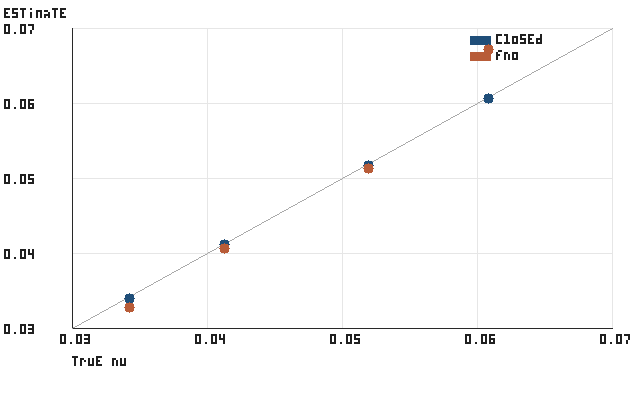

# PINNForge

Recover the hidden viscosity `ν` of 1D viscous Burgers from sparse, noisy sensor readings.
Measure when a learned operator beats running the solver, and when it doesn't.

PINNForge is a CPU research sandbox: a dealiased Fourier/ETDRK4 Burgers reference, a small 1D Fourier neural operator (FNO) trained with a data loss or a hybrid physics-informed loss, a frozen protocol and a committed score file for every study stage, and a claim checker (`pinnforge claims check`) that ties the numbers and comparisons in this README to those files. The latest tag is `v0.3.0`. A coordinate-MLP PINN trainer and a localhost API from v0.1.0 are still included.

## Results on `hard_ood`, `sensors32_bursts`

Each row recovers `ν` on the 30 `hard_ood` test instances of the Stage A harder Burgers pilot (`ν` at or below the lower quartile of the training split). Inputs are 32 equispaced sensors over four bursts of five frames (the Stage D `sensors32_bursts` mask). A failure is `ν̂ <= 0` or relative error above `0.5`. FNO rows are the mean over five training seeds. Error values are rounded to at most three significant figures from [docs/research/strong_baselines_scores.json](docs/research/strong_baselines_scores.json).

| estimator | reads | mean relative error | failures (of 30) |
| --- | --- | ---: | ---: |
| closed-form residual least squares | sensors | 0.349 | 9 |
| weak-form identifier | sensors | 0.090 | 0 |
| FNO, data loss | sensors | 0.049 | 0 |
| FNO, hybrid physics loss (weight `1e-2`) | sensors | 0.034 | 0 |
| solver in the loop, sensor-lift initial condition | sensors | 0.0138 | 0 |
| solver in the loop, oracle initial condition (ceiling) | full field at `t = 0`, then sensors | 0.0025 | 0 |

On this slice the FNO mean relative error is lower than the closed form and the weak form, and higher than the solver-in-the-loop fit from a sensor-lifted initial condition. The oracle row is a ceiling, not a sparse-sensor method, because it reads the full initial field.

Wall clock per instance on one CPU: about 19 s for the sensor-lift solver fit (coarse grid plus golden-section search, every forward solve included) and about 2 s for one FNO inversion over the 191-point `ν` grid. The FNO time excludes training the network, and it was measured with randomly initialized weights of the Stage D architecture because the trained checkpoints are not committed. The solver needs no training.

## Where the operator breaks

- **Noise and sparsity (Stage E).** Both FNO arms stay under 10% mean relative error with no failures through 1% noise (of the field standard deviation). Both cross 10% and start failing at 2% noise, and at 16 clean sensors. At 5% noise the closed form wins on `hard_ood`: 0.299 against 0.750 (data loss) and 0.835 (hybrid). On the same noisy `hard_ood` cells the sensor-lift solver stays at 0.0142 (2% noise) and 0.0182 (5% noise). At 16 clean sensors that solver degrades as well (0.154, 2 failures), close to the FNO arms (0.175 and 0.161). [STAGE_E_REPORT.md](STAGE_E_REPORT.md), [docs/research/strong_baselines.md](docs/research/strong_baselines.md).
- **Out of distribution (Stage F).** Trained only on `ν` above the `hard_ood` cut, the FNO one-step forecast error on the held-out low-viscosity slice is about 11 times its in-range error (data loss; 12 for hybrid). The viscosity inverse error on that slice rises to 0.233 (data loss) and 0.213 (hybrid). The hybrid physics loss does not close the gap: its out-of-distribution to in-range ratio is larger than the data loss, and the paired per-seed differences change sign. [STAGE_F_REPORT.md](STAGE_F_REPORT.md).
- **Smooth data.** On the small smooth demo below, the closed form is more accurate than the FNO.

## Quickstart

Python 3.11 or newer. Install a CPU torch wheel first so the `ml` extra does not pull CUDA.

```bash
python -m venv .venv
source .venv/bin/activate
pip install torch --index-url https://download.pytorch.org/whl/cpu
pip install -e ".[ml,api]"
pinnforge --help
pinnforge demo burgers-inverse --output runs/burgers-inverse
pinnforge claims check
```

`pinnforge demo burgers-inverse` solves 24 periodic Burgers problems, trains a width-24 FNO for 40 epochs, and writes `result.json`, `result.md`, `index.html`, and three PNG plots under `runs/burgers-inverse` (`runs/` is gitignored). `pinnforge claims check` needs no torch. `pinnforge fno --help` lists the stage commands; the stage score files were produced on pilot arrays that are regenerated, not committed (see each report).

`pinnforge serve` exposes the same demo as `POST /demo/burgers-inverse` on `127.0.0.1:8000`, with no authentication and a per-client rate limit. Details are in [docs/architecture.md](docs/architecture.md).

## Demo: smooth Burgers inverse

A different, easier experiment than the table above: 16 train, 4 validation, and 4 test trajectories, 4 Fourier modes of initial data, viscosities drawn uniformly from `[0.02, 0.08]`, 32 sensors on every saved frame. The committed run (Python 3.12.3, NumPy 1.26.4, torch 2.14.1+cpu, one torch thread) took `2.77327819e+00` seconds of script wall clock, from:

```bash
pinnforge demo burgers-inverse --output runs/burgers-inverse
```

```text
estimator                n   mean abs  mean rel  max rel  failures
-----------------------  -  ---------  --------  -------  --------
closed form, 32 sensors  4  1.670e-04     0.41%    0.71%         0
FNO sensor match         4  2.556e-03     4.97%   11.85%         0
training-mean constant   4  1.052e-02    25.93%   54.20%         1
```

On this smooth sample the closed form wins (0.41% vs 4.97% mean relative error). On the hard-OOD Stage D slice the FNO mean relative error is lower than the closed form (STAGE_D_REPORT.md) and higher than the sensor-lift solver (docs/research/strong_baselines.md).

<details>
<summary>Full precision</summary>

| estimator | n | mean abs error | mean rel error | max rel error | failures |
| --- | ---: | ---: | ---: | ---: | ---: |
| closed form, 32 sensors | 4 | 1.66974755e-04 | 4.05968068e-03 | 7.08700857e-03 | 0 |
| FNO sensor match | 4 | 2.55609737e-03 | 4.96650095e-02 | 1.18468303e-01 | 0 |
| training-mean constant | 4 | 1.05151535e-02 | 2.59304474e-01 | 5.41994932e-01 | 1 |

Data-only FNO, width 24, modes 8, layers 2, 21172 parameters, 40 Adam epochs, seed 0. Selected epoch 40 by validation relative L2 `3.69904987e-02`. Viscosity grid step `1.00000000e-03`. The closed form is the normal equation of the central Burgers residual on the sensors. The FNO lifts the first four frames, rolls forward, and keeps the grid point whose predicted sensors best match the later frames.

</details>



Other plots: [relative error](docs/demo/relative_error.png), [first test field and sensors](docs/demo/field_sensors.png). The same tables are in [docs/demo/result.md](docs/demo/result.md) and [docs/demo/index.html](docs/demo/index.html); `tests/test_demo_inverse.py` checks them against [docs/demo/result.json](docs/demo/result.json).

## Stage reports

[docs/README.md](docs/README.md) maps every report, protocol, and score file, including the v0.1 Stages 1–5.

| stage | question | report | scores |
| --- | --- | --- | --- |
| A | harder Burgers pilot and the frozen `hard_ood` cut | [STAGE_A_REPORT.md](STAGE_A_REPORT.md) | [docs/v02/inverse_stress.json](docs/v02/inverse_stress.json) |
| B | data-loss FNO, five seeds | [STAGE_B_REPORT.md](STAGE_B_REPORT.md) | [docs/v02/stage_b_scores.json](docs/v02/stage_b_scores.json) |
| C | residual and hybrid physics losses | [STAGE_C_REPORT.md](STAGE_C_REPORT.md) | [docs/v02/stage_c_scores.json](docs/v02/stage_c_scores.json) |
| D | FNO-conditioned viscosity inverse on `sensors32_bursts` | [STAGE_D_REPORT.md](STAGE_D_REPORT.md) | [docs/v02/stage_d_scores.json](docs/v02/stage_d_scores.json) |
| E | noise and sensor sparsity | [STAGE_E_REPORT.md](STAGE_E_REPORT.md) | [docs/v02/stage_e_scores.json](docs/v02/stage_e_scores.json) |
| F | out-of-distribution viscosity | [STAGE_F_REPORT.md](STAGE_F_REPORT.md) | [docs/v02/stage_f_scores.json](docs/v02/stage_f_scores.json) |
| G | claim-to-evidence checker | [docs/v02/stage_g_claims.md](docs/v02/stage_g_claims.md) | [docs/claims.yaml](docs/claims.yaml) |
| research | weak-form and solver-in-the-loop baselines | [docs/research/strong_baselines.md](docs/research/strong_baselines.md) | [docs/research/strong_baselines_scores.json](docs/research/strong_baselines_scores.json) |
| v0.3 | FNO-warm-started solver fit with calibrated intervals and an abstain flag | [docs/v03/warmstart.md](docs/v03/warmstart.md) | [docs/v03/warmstart_scores.json](docs/v03/warmstart_scores.json) |
| v0.4 | 2D Burgers and vorticity-form Navier-Stokes viscosity inverse; both problems fail the preregistered bars | [docs/v04/report.md](docs/v04/report.md) | [docs/v04/scores.json](docs/v04/scores.json) |
| v06 | The Well shear_flow nu/kappa inverse; fails the preregistered bars | [docs/v06/report.md](docs/v06/report.md) | [docs/v06/scores.json](docs/v06/scores.json) |

## What is NOT claimed

- The FNO inverse is not the most accurate method on `hard_ood`. The sensor-lift solver has lower error than both FNO arms. It is slower per instance and needs no training.
- The oracle initial-condition solver is a ceiling. It reads the full field at `t = 0`.
- One equation (1D periodic Burgers), one scalar parameter, one pilot dataset. This is not a benchmark across PDEs or across operator architectures.
- Wall clocks are one CPU and are not a hardware benchmark. The FNO time excludes training and used random weights of the trained architecture.
- The hybrid physics loss lowers in-distribution error. It does not fix noise robustness or out-of-distribution extrapolation.
- The smooth-demo result and the `hard_ood` result do not transfer to each other.
- No width, mode count, depth, or loss weight is claimed optimal outside the set frozen before the run that measured it.
- Pilot arrays and FNO checkpoints are not committed. CI does not retrain the stage studies. `pinnforge claims check` compares this text with committed JSON; it does not recompute it.

## Development

```bash
pip install torch --index-url https://download.pytorch.org/whl/cpu
pip install -e ".[dev,api,lint]"
pytest
ruff check .
pinnforge claims check
```

`pytest -m "not ml"` runs without torch. CI runs that suite on Python 3.11 and 3.12, the full suite with CPU torch, the demo command, `ruff check`, and `python -m pinnforge.claims check`. Release history is in [CHANGELOG.md](CHANGELOG.md).

## License

MIT. See [LICENSE](LICENSE).

The v06 subset of The Well `shear_flow` (Ohana et al.) is used under CC BY 4. File names, byte sizes, and SHA-256 hashes are in [docs/v06/download_manifest.json](docs/v06/download_manifest.json). Raw HDF5 is not in this repository.
