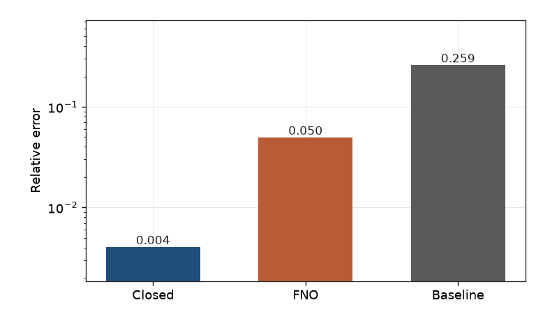
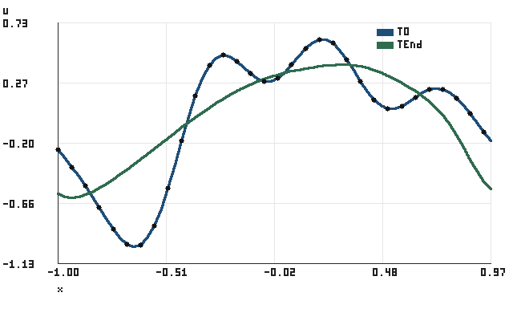

# PINNForge

PINNForge is a CPU sandbox for a few classic physics-informed residuals, plus one operator inverse problem that is small enough to rerun. The equation side covers a harmonic oscillator, viscous Burgers in one dimension, and a Poisson toy. The inverse demo trains a small Fourier neural operator on periodic Burgers trajectories and recovers the viscosity from 32 sparse sensors, then compares that fit with the closed-form residual least squares estimator. Version 0.2.2 is the tree described here. The annotated tag is not created in this commit. v0.1.0 remains the previous sandbox freeze.

## Quickstart

Python 3.11 or newer. Install a CPU torch wheel first so the `ml` extra does not pull CUDA.

```bash
python -m venv .venv
source .venv/bin/activate
pip install torch --index-url https://download.pytorch.org/whl/cpu
pip install -e ".[ml,api]"
pinnforge demo burgers-inverse --output runs/burgers-inverse
```

That command solves 24 periodic Burgers problems, trains a width-24 FNO for 40 epochs, and writes `result.json`, `result.md`, `index.html`, and three PNG plots under `runs/burgers-inverse`. The script's own wall clock for the committed run, covering the solve, the training, the recovery, and the plots, is `2.77327819e+00` seconds with torch limited to one thread. `runs/` is gitignored. The same demo is `POST /demo/burgers-inverse`.

```bash
pinnforge serve
```

In another shell:

```bash
curl -s -X POST http://127.0.0.1:8000/demo/burgers-inverse \
  -H 'content-type: application/json' \
  -d '{"output":"runs/burgers-inverse"}'
```

The server binds `127.0.0.1:8000`. There is no authentication. `POST /train`, `POST /eval`, `POST /run`, and `POST /demo/burgers-inverse` share a limit of 60 requests per 60 seconds per client. A relative path that leaves the working directory is rejected. On the CLI, `--output` may be an absolute directory. The API `output` field stays relative to the sandbox root.

`pinnforge demo` with no case still trains the checked-in harmonic sample (`samples/configs/harmonic.yaml`, 2 epochs) and prints the error against the closed form. `--equation poisson` and `--equation burgers` use the other checked-in samples. Burgers evaluation on that path reports residual metrics only, because the coordinate network has no closed-form field.

## Results

The command prints this table. Relative errors are percents of the true viscosity. [docs/demo/result.md](docs/demo/result.md) and [docs/demo/index.html](docs/demo/index.html) lead with the same table and the sentence under it. The copy in the tree is that run (Python 3.12.3, NumPy 1.26.4, torch 2.14.1+cpu, one torch thread), from:

```bash
pinnforge demo burgers-inverse --output runs/burgers-inverse
```

`tests/test_demo_inverse.py` checks that this table and the full-precision table match [docs/demo/result.json](docs/demo/result.json).

```text
estimator                n   mean abs  mean rel  max rel  failures
-----------------------  -  ---------  --------  -------  --------
closed form, 32 sensors  4  1.670e-04     0.41%    0.71%         0
FNO sensor match         4  2.556e-03     4.97%   11.85%         0
training-mean constant   4  1.052e-02    25.93%   54.20%         1
```

On this smooth sample the closed form wins (0.41% vs 4.97% mean relative error). On the hard-OOD Stage D slice the FNO mean relative error is lower than the closed form (STAGE_D_REPORT.md) and higher than the sensor-lift solver (docs/research/strong_baselines.md).

Full precision:

| estimator | n | mean abs error | mean rel error | max rel error | failures |
| --- | ---: | ---: | ---: | ---: | ---: |
| closed form, 32 sensors | 4 | 1.66974755e-04 | 4.05968068e-03 | 7.08700857e-03 | 0 |
| FNO sensor match | 4 | 2.55609737e-03 | 4.96650095e-02 | 1.18468303e-01 | 0 |
| training-mean constant | 4 | 1.05151535e-02 | 2.59304474e-01 | 5.41994932e-01 | 1 |

Data-only FNO, width 24, modes 8, layers 2, 21172 parameters, 40 Adam epochs, seed 0. Selected epoch 40 by validation relative L2 `3.69904987e-02`. Viscosity grid step `1.00000000e-03`. Failure means a nonpositive estimate or a relative error above 0.5. The training-mean row has one such case.

Both estimators read the same 32 equispaced sensors on every saved frame (`x` in `[-1, 1)`, `N = 64`, `save_dt = 0.02`). The closed form is `nu_hat = (a · b) / (b · b)` with residual `R = a - nu b` from the central stencil. The FNO never sees the true viscosity. It lifts the first four frames, rolls forward, and keeps the grid point whose predicted sensors best match the later frames. Ties keep the smaller viscosity.


Blue points are the closed form. Orange points are the FNO. The gray line is equality.



The bars are the mean relative errors above. The axis is log10 because the three values span more than a factor of eight. The labels on the bars are the relative errors.



The first held-out trajectory at the first and last saved frames. Black dots are the 32 sensors on the first frame.

A static page with the same tables and figures is [docs/demo/index.html](docs/demo/index.html). Per-instance rows are in the JSON.

## Limitations

The demo uses 16 train, 4 validation, and 4 test trajectories, initial data with 4 Fourier modes, and viscosities drawn uniformly from `[0.02, 0.08]`. On that smooth sample the closed form (mean relative error `4.05968068e-03`) is more accurate than the FNO (`4.96650095e-02`). The 32-sensor grid still resolves `u_xx` here, so the normal equation is the right tool. The FNO estimate is also quantized by the `0.001` search grid.

The harder pilot, where 32 sensors alias and the operator is the interesting estimator, is the Stage D study in [STAGE_D_REPORT.md](STAGE_D_REPORT.md) and [docs/v02/stage_d_scores.json](docs/v02/stage_d_scores.json). Stages E and F are the noise and out-of-distribution follow-ups. Those score files were produced by `pinnforge fno` on pilot arrays that are not in git (`artifacts/` is gitignored, and the checkpoints are not committed). This demo does not retrain them. `tests/test_published_scores.py` checks the changelog headlines against those JSON files. It does not recompute them.

The coordinate Burgers network still has no manufactured reference field, so `pinnforge eval --equation burgers` reports the residual only. The API has no authentication. A fresh run on another CPU can move the last digits of the demo table. The wall clock above is this machine, with torch limited to one thread.

## Architecture

```
periodic Burgers (Fourier, ETDRK4, x in [-1, 1))
        |
        +-- train / val instances, known viscosity
        |         |
        |         v
        |     1D FNO: input frames + normalized nu -> next frames
        |
        +-- test instances, viscosity hidden
                  |
                  v
        32 equispaced sensors on every saved frame
                  |
                  +-- closed form: nu_hat = (a · b) / (b · b)
                  |
                  +-- FNO: lift the first window, roll forward,
                      choose nu on a fixed grid by sensor mean square
```

The rest of the sandbox is a coordinate MLP. `pinnforge train` and `pinnforge eval` fit `u(x, t)` to a residual plus soft initial and boundary penalties, then score a harmonic closed form or a manufactured Poisson field. Experiment files go through `pinnforge run`. `pinnforge serve` exposes that path on localhost, keeps paths inside a sandbox root, and refuses non-loopback TCP from the process. Details are in [docs/architecture.md](docs/architecture.md).

## Tests

```bash
pip install -e ".[dev,api,lint]"
pytest -m "not ml"
ruff check .
```

The inverse demo, the MLP trainer, and the HTTP train path need torch:

```bash
pip install torch --index-url https://download.pytorch.org/whl/cpu
pip install -e ".[dev,api]"
pytest
pinnforge demo burgers-inverse --output runs/burgers-inverse
```

Default CI runs the suite without torch on Python 3.11 and 3.12, a CPU-torch job with the full suite, a smoke job that runs the demo command above, `ruff check`, and `python -m pinnforge.claims check`.

## License

MIT. See [LICENSE](LICENSE).
