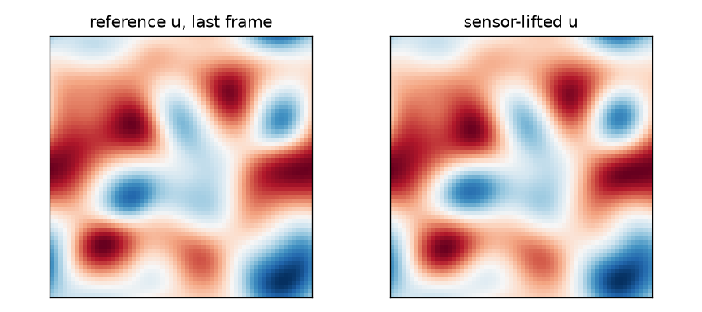
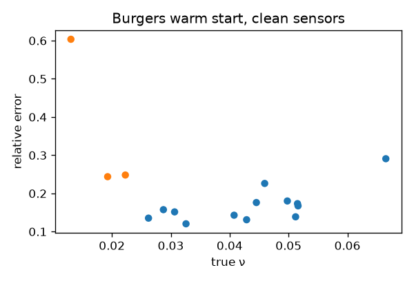
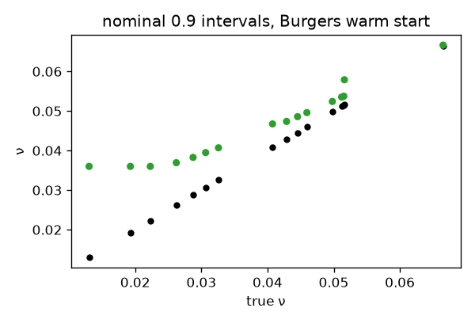

# v0.4 2D viscosity inverse

Research note. The contract is [protocol.json](protocol.json). Its SHA-256 is stored as `protocol_sha256` in [scores.json](scores.json). Hashes of the committed JSON files are in [reproducibility.md](reproducibility.md). Calibration is [validation.json](validation.json). No hyperparameter was chosen on the test split.

## Question

Can a 2D FNO first guess plus a bounded solver-in-the-loop refinement recover a scalar viscosity on periodic 2D Burgers and 2D incompressible Navier-Stokes (vorticity form) from sparse noisy probes, with a frozen low-nu hard_ood slice, calibrated nominal 0.9 intervals, and wall clock well below a cold solver search?

## Pass / fail

Bars were frozen before scoring. They are not retuned.

| problem | in-dist `ν` error `<= 0.05` | hard_ood / complement `<= 3` | warm error `<= 1.5×` cold | warm time `<= 0.25×` cold | coverage in `[0.85, 0.95]` | overall |
| --- | --- | --- | --- | --- | --- | --- |
| burgers2d | fail (0.168616089900106) | pass (2.165961805159777) | fail (0.3652160104590167) | pass (0.1824314220654769) | fail (1) | fail |
| ns2d | fail (0.3245006510224735) | pass (0.6325677829103797) | fail (0.2052686573702609) | pass (0.1777621040176008) | fail (1) | fail |

Primary method: hybrid-FNO warm start, five-seed mean. Primary problem: `burgers2d`. Both problems fail overall. The time bar passes. The in-distribution error bar, the warm-versus-cold error bar, and the coverage bar fail. Coverage is 1 because the validation split has 8 instances, so the split-conformal rank `ceil((n + 1)(1 - alpha))` is 9 and the quantile is infinite. That is a fail of the frozen coverage bar, not a retune.

## Headline tables (clean sensors)

### burgers2d

| method | complement rel err | hard_ood rel err | failures | mean seconds |
| --- | ---: | ---: | ---: | ---: |
| closed-form residual LS | 0.1061219543363312 | 0.2999148128445531 | 1 | 0 |
| weak form | 1.0714421783758 | 0.6867814942051296 | 1 | 0 |
| FNO inverse, data loss | 0.4250032760039676 | 0.8934761096732253 | 1.6 | 0.1339147252874994 |
| FNO inverse, hybrid loss | 0.5231465619444131 | 1.239386375414692 | 1.6 | 0.1377092877875128 |
| cold solver, sensor-lift IC | 0.004404494487213693 | 0.009413578381037275 | 0 | 7.958017182125019 |
| oracle-IC solver (ceiling) | 0.004404494487213693 | 0.009413578381037275 | 0 | 7.585165372749998 |
| warm start, data-loss FNO | 0.1478017184898531 | 0.2116591269348808 | 0.4 | 1.401834058762492 |
| warm start, hybrid FNO | 0.168616089900106 | 0.3652160104590167 | 0.8 | 1.424169551000014 |

Warm-start coverage on full test: 1. Abstain rate: 0.0625. Time / cold on hard_ood: 0.1824314220654769.

### ns2d

| method | complement rel err | hard_ood rel err | failures | mean seconds |
| --- | ---: | ---: | ---: | ---: |
| closed-form residual LS | 0.05365268778667846 | 0.06138714862708261 | 0 | 0 |
| weak form | 1.269753677656077 | 1.297877796014071 | 2 | 0 |
| FNO inverse, data loss | 0.7389168355561287 | 0.2908246652409492 | 0 | 0.1206228941749941 |
| FNO inverse, hybrid loss | 0.7441866512832163 | 0.7142585395189309 | 0.8 | 0.1236042862250429 |
| cold solver, sensor-lift IC | 0.04999049708015536 | 0.09507835331424035 | 0 | 4.889825600062409 |
| oracle-IC solver (ceiling) | 0.004404494487213693 | 0.009413578381037275 | 0 | 4.786143239062483 |
| warm start, data-loss FNO | 0.3356842844489884 | 0.08457803085044653 | 0 | 0.917056133074999 |
| warm start, hybrid FNO | 0.3245006510224735 | 0.2052686573702609 | 0.2 | 0.9327442102375585 |

Warm-start coverage on full test: 1. Abstain rate: 0.0125. Time / cold on hard_ood: 0.1777621040176008.

## Noise

Calibration is the clean validation one. Nothing is refit.

| problem | noise | cold hard_ood | warm hybrid hard_ood | warm time / cold | coverage |
| --- | ---: | ---: | ---: | ---: | ---: |
| burgers2d | 0.0 | 0.009413578381037275 | 0.3652160104590167 | 0.1824314220654769 | 1 |
| burgers2d | 0.01 | 0.03577707450559459 | 0.359949275266104 | 0.185806754809492 | 1 |
| burgers2d | 0.02 | 0.1624123003398161 | 0.4451356768188631 | 0.1898149076458647 | 1 |
| burgers2d | 0.05 | 0.3464706195031281 | 0.5676377167077508 | 0.1912941738684532 | 1 |
| ns2d | 0.0 | 0.09507835331424035 | 0.2052686573702609 | 0.1777621040176008 | 1 |
| ns2d | 0.01 | 0.07797652734225351 | 0.1855458175571677 | 0.1876164889450407 | 1 |
| ns2d | 0.02 | 0.1309604384968816 | 0.2092071171419027 | 0.2061871430867581 | 1 |
| ns2d | 0.05 | 0.1470418766734453 | 0.2631829036995834 | 0.2044286165077395 | 1 |

## Figures







## What is NOT claimed

- a result on The Well shear_flow or Petrobras 3W
- 3D or time-dependent 3D+time
- that the warm start is more accurate than the cold search; the bar is accuracy within a factor of the cold search
- coverage conditional on viscosity, on noise level, or outside the training range
- that the abstain flag detects every large error
- a retuned hard_ood rule after seeing test scores
- an architecture, width, mode count, or loss weight that is optimal outside this frozen set
- speed-ups on other machines, GPUs, or other solvers

## Reproduce

```bash
python -m pinnforge.v04 generate
python -m pinnforge.v04 train
python -m pinnforge.v04 score
python -m pinnforge.v04 report
python -m pinnforge.claims check
```

CI runs `python -m pinnforge.v04 smoke` only. Pilot arrays are regenerated, not committed.

