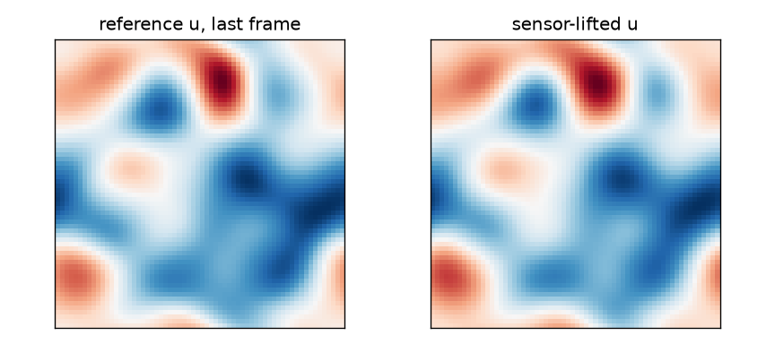
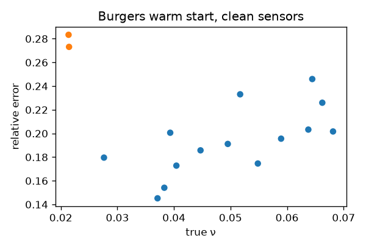
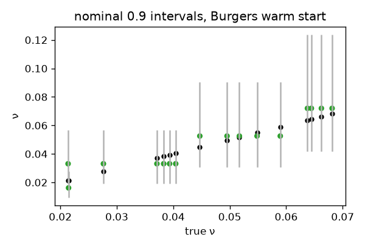

# v0.4.1 2D viscosity inverse

Research note. The contract is [protocol.json](protocol.json). Its SHA-256 is stored as `protocol_sha256` in [scores.json](scores.json). Hashes of the committed JSON files are in [reproducibility.md](reproducibility.md). Calibration is [validation.json](validation.json). No v0.4 artifact was edited. No hyperparameter was chosen on the test split.

## Question

With a calibration split of at least 60 instances disjoint from train and test, can an FNO-located conformal bracket plus a short local solver search recover a scalar viscosity on the same 2D Burgers and vorticity-form Navier-Stokes problems, against the frozen v0.4 pass bars?

## Pass / fail

Bars are the frozen v0.4 bars. They are not retuned.

| problem | in-dist `ν` error `<= 0.05` | hard_ood / complement `<= 3` | warm error `<= 1.5×` cold | warm time `<= 0.25×` cold | coverage in `[0.85, 0.95]` | overall |
| --- | --- | --- | --- | --- | --- | --- |
| burgers2d | fail (0.1935262883992378) | pass (1.437742161008972) | fail (0.2782409040951657) | fail (0.2675242235675497) | pass (0.8875) | fail |
| ns2d | fail (0.1644008163517979) | pass (1.916599815211676) | fail (0.3150905742405045) | fail (0.2744663287545415) | pass (0.8625) | fail |

Primary method: hybrid-FNO bracket plus local solver search, five-seed mean. Primary problem: `burgers2d`. Both problems fail overall. burgers2d missed in_distribution_error, warm_vs_cold_error, warm_vs_cold_time. burgers2d passed hard_ood_gap, coverage. ns2d missed in_distribution_error, warm_vs_cold_error, warm_vs_cold_time. ns2d passed hard_ood_gap, coverage.

## Versus v0.4 (same frozen bars)

v0.4 numbers are copied from [docs/v04/scores.json](../v04/scores.json). They were not recomputed. The v0.4.1 bars were not retuned.

| problem | bar | v0.4 | v0.4.1 |
| --- | --- | --- | --- |
| burgers2d | in-dist `ν` error `<= 0.05` | fail (0.168616089900106) | fail (0.1935262883992378) |
| burgers2d | hard_ood / complement `<= 3` | pass (2.165961805159777) | pass (1.437742161008972) |
| burgers2d | warm error `<= 1.5×` cold | fail (0.3652160104590167) | fail (0.2782409040951657) |
| burgers2d | warm time `<= 0.25×` cold | pass (0.1824314220654769) | fail (0.2675242235675497) |
| burgers2d | coverage in `[0.85, 0.95]` | fail (1) | pass (0.8875) |
| burgers2d | overall | fail | fail |
| ns2d | in-dist `ν` error `<= 0.05` | fail (0.3245006510224735) | fail (0.1644008163517979) |
| ns2d | hard_ood / complement `<= 3` | pass (0.6325677829103797) | pass (1.916599815211676) |
| ns2d | warm error `<= 1.5×` cold | fail (0.2052686573702609) | fail (0.3150905742405045) |
| ns2d | warm time `<= 0.25×` cold | pass (0.1777621040176008) | fail (0.2744663287545415) |
| ns2d | coverage in `[0.85, 0.95]` | fail (1) | pass (0.8625) |
| ns2d | overall | fail | fail |

## Headline tables (clean sensors)

### burgers2d

| method | complement rel err | hard_ood rel err | failures | mean seconds |
| --- | ---: | ---: | ---: | ---: |
| closed-form residual LS | 0.1110966206404174 | 0.1685517066609178 | 0 | 0 |
| weak form | 1.25775565834704 | 1.77749648538856 | 2 | 0 |
| FNO inverse, data loss | 0.4703242503866213 | 0.7694936515638053 | 1.2 | 0.07014121783750937 |
| FNO inverse, hybrid loss | 0.53513736244234 | 0.69497722870725 | 1 | 0.06996748026248838 |
| cold solver, sensor-lift IC | 0.00368899751376279 | 0.01765636586119127 | 0 | 5.61587485593752 |
| oracle-IC solver (ceiling) | 0.00368899751376279 | 0.01765636586119127 | 0 | 5.620409213750008 |
| warm start, data-loss FNO bracket | 0.1910664740478059 | 0.2347121174088052 | 0 | 1.499042866175006 |
| warm start, hybrid FNO bracket | 0.1935262883992378 | 0.2782409040951657 | 0.2 | 1.49972635366249 |

Warm-start coverage on full test: 0.8875. Abstain rate: 0.4625. Time / cold on hard_ood: 0.2675242235675497. n_local: 3.

### ns2d

| method | complement rel err | hard_ood rel err | failures | mean seconds |
| --- | ---: | ---: | ---: | ---: |
| closed-form residual LS | 0.04588215183135068 | 0.1264187587587711 | 0 | 0 |
| weak form | 1.100675435088671 | 0.7774683376012119 | 1 | 0 |
| FNO inverse, data loss | 0.6422633313685695 | 1.409777350661816 | 1.4 | 0.07103144248750083 |
| FNO inverse, hybrid loss | 0.6159284097514306 | 1.323733108465308 | 1.2 | 0.07123523633749755 |
| cold solver, sensor-lift IC | 0.05315998139936481 | 0.1979211160413175 | 0 | 3.980184250812513 |
| oracle-IC solver (ceiling) | 0.00368899751376279 | 0.01765636586119127 | 0 | 3.991187481875016 |
| warm start, data-loss FNO bracket | 0.149521484374478 | 0.3558427572688428 | 0 | 1.077662100962476 |
| warm start, hybrid FNO bracket | 0.1644008163517979 | 0.3150905742405045 | 0 | 1.078657752737487 |

Warm-start coverage on full test: 0.8625. Abstain rate: 0.2625. Time / cold on hard_ood: 0.2744663287545415. n_local: 3.

## Noise

Calibration is the clean calibration split. Nothing is refit.

| problem | noise | cold hard_ood | warm hybrid hard_ood | warm time / cold | coverage |
| --- | ---: | ---: | ---: | ---: | ---: |
| burgers2d | 0.0 | 0.01765636586119127 | 0.2782409040951657 | 0.2675242235675497 | 0.8875 |
| burgers2d | 0.01 | 0.05014195841838017 | 0.3003729748333354 | 0.2586072315227568 | 0.875 |
| burgers2d | 0.02 | 0.05677715809976187 | 0.2824151107286793 | 0.2614219733288632 | 0.8875 |
| burgers2d | 0.05 | 0.1346223445573244 | 0.3035704974521336 | 0.261597163987529 | 0.9 |
| ns2d | 0.0 | 0.1979211160413175 | 0.3150905742405045 | 0.2744663287545415 | 0.8625 |
| ns2d | 0.01 | 0.1829783030715693 | 0.3150905742405045 | 0.2712174329991823 | 0.8500000000000001 |
| ns2d | 0.02 | 0.5634067637572335 | 0.6649541966541072 | 0.2711755830138876 | 0.775 |
| ns2d | 0.05 | 0.8020375630579348 | 0.752290837026894 | 0.2723731425328921 | 0.7250000000000001 |

## Figures







## What is NOT claimed

- a result on The Well shear_flow or Petrobras 3W
- 3D or time-dependent 3D+time
- that the warm start is more accurate than the cold search; the bar is accuracy within a factor of the cold search
- coverage conditional on viscosity, on noise level, or outside the training range
- that the abstain flag detects every large error
- a retuned hard_ood rule after seeing test scores
- an architecture, width, mode count, or loss weight that is optimal outside this frozen set
- speed-ups on other machines, GPUs, or other solvers
- a change to any v0.4 number, protocol, or score file
- that a larger FNO or a longer training run would have passed v0.4

## Reproduce

```bash
python -m pinnforge.v041 generate
python -m pinnforge.v041 train
python -m pinnforge.v041 score --checkpoint docs/v041/score_cases.jsonl
python -m pinnforge.v041 report
python -m pinnforge.claims check
```

CI runs `python -m pinnforge.v041 smoke` only. Pilot arrays are regenerated, not committed. Finished cases are in [score_cases.jsonl](score_cases.jsonl).

